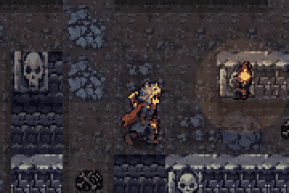

# 미궁의 사냥꾼

괴물의 미로에 갇힌 사냥꾼이 공주를 구하고 탈출하는 도트 판타지 미로 게임입니다.
은목제 부스용으로 만들었고, 설치 없이 브라우저에서 바로 플레이할 수 있습니다.

**▶ 플레이하기: https://vecar0.github.io/Maze/**



## 목표

1. 미로 어딘가의 **수면 석궁**을 찾는다
2. 중앙 둥지의 **공주를 구출**한다 (3칸 게이지)
3. 동·서·남·북 네 구역의 상자에서 **열쇠 조각 4개**를 모은다
4. 공주를 데리고 **출구로 탈출**한다

## 조작법

| | 모바일 | PC |
|---|---|---|
| 이동 | 왼쪽 조이스틱 | WASD / 방향키 |
| 달리기 | 조이스틱을 끝까지 밀기 | Shift |
| 구출·상자 열기·목재 철거 | 오른쪽 큰 버튼 (상황에 따라 바뀜) | E |
| 수면 석궁 | 석궁 버튼 | F |
| 목재 설치 (등 뒤) | 목재 버튼 | Space |
| 미끼 던지기 | 미끼 버튼 | Q |
| 재시작 | 상단 ↻ 버튼 (두 번 누르기) | R |

## 규칙

- **구출**은 3칸입니다. 한 칸을 채울 때마다 공주가 비명을 지르고, 괴물이 무엇을 하고 있었든 둥지로 달려옵니다. 다음 칸은 5초 뒤에 열립니다.
- **수면 석궁**을 맞히면 괴물이 8초간 잠듭니다. 화살은 미로 곳곳에서 보충할 수 있습니다.
- **목재**는 등 뒤에 세워져 따라오는 괴물을 막습니다. 괴물은 두 번 들이받으면 부숩니다. 갇히면 E로 언제든 철거할 수 있습니다.
- **미끼**를 던지면 괴물이 4초간 먹느라 플레이어를 무시합니다.
- **구덩이**(붉은 테두리)에 빠지면 목재·화살·미끼를 모두 잃고 네 구역 중 한 곳으로 떨어집니다. 구출한 공주는 둥지로 돌아가니 다시 데리러 가야 합니다.
- 금색 테두리가 있는 것은 주울 수 있거나 열 수 있는 오브젝트입니다.
- 열쇠 조각을 2개 모으면 미로에 물자가 다시 나타납니다.

## 연출

- **도입 장면** — 시작 버튼을 누르면 짧은 이야기가 나옵니다 (화면을 누르면 넘어가고, 건너뛰기 가능). 다시 하기·재시작은 바로 시작합니다.
- **조명** — 횃불·화로·상자·출구 주변이 밝고, 구역마다 어둠의 색이 다릅니다. 시야를 가리지는 않습니다.
- **구역 분위기** — 북은 눈발, 동은 불티, 남은 반딧불, 서는 먼지, 중앙은 붉은 재가 떠다닙니다.
- **손맛** — 발걸음 먼지, 맞을 때 잠깐 멈춤(히트스톱), 목재 파편, 상자에서 열쇠 조각이 HUD로 날아가는 연출, 괴물이 추격을 시작하면 머리 위 "!".
- **소리** — 모두 코드로 합성합니다. 낮은 울림의 배경음, 추격 중엔 빨라지는 박자, 괴물이 가까우면 심장 소리, 구역마다 다른 발소리. 상단 왼쪽 🔊 버튼으로 끄고 켤 수 있고 기기에 기억됩니다.
- **기록** — 결과 화면에 맞은 횟수·쏜 화살·구덩이·미끼·목재 사용 횟수가 나오고, 클리어하면 이름 3글자로 기록 순위(상위 8개, 이 기기에 저장)에 올릴 수 있습니다. 제목 화면에 최고 기록이 표시됩니다.

## 구역

| 방향 | 구역 |
|---|---|
| 북 | 얼어붙은 회랑 |
| 동 | 불의 대장간 |
| 남 | 이끼 낀 수로 |
| 서 | 뼈의 묘지 |
| 중앙 | 괴물의 둥지 |

미로는 판마다 새로 생성됩니다. 막다른 길이 없고, 구덩이는 항상 옆으로 돌아갈 수 있는 자리에만 놓입니다.

## 자동 검수

```
pip install playwright && playwright install chromium
python3 tests/qa.py        # 로직 시뮬레이션 55개 + 브라우저 실제 플레이 40개
```

미로 200판 생성 검사, 단계 진행, 구출·도구·구덩이 규칙, 무적 봇 120판 완주, 무작위 입력 5분,
휴대폰 화면 터치 조작, 도입 장면, 결과 화면·순위표, 소리 설정 저장, 효과 입자 상한,
한 프레임 처리 시간, 레이아웃, 콘솔 에러 0을 확인합니다.
고친 내용과 이유는 `tests/progress.txt`에 남겨 두었습니다.

## 파일 구성

```
index.html      게임 전체 (그래픽·효과음 포함, 이 파일 하나로 동작)
art/sprites/    캐릭터·아이템 도트 스프라이트
art/tiles/      구역별 벽·바닥 타일 (32×32)
assets/         README 미리보기
tests/          자동 검수 (qa.py · sim.js · ui.py · progress.txt)
```

## 제작

- 기획: 송휘
- 캐릭터·배경 설정화: Higgsfield로 생성 후 게임용 도트로 변환
- 게임 코드: Claude와 함께 제작
